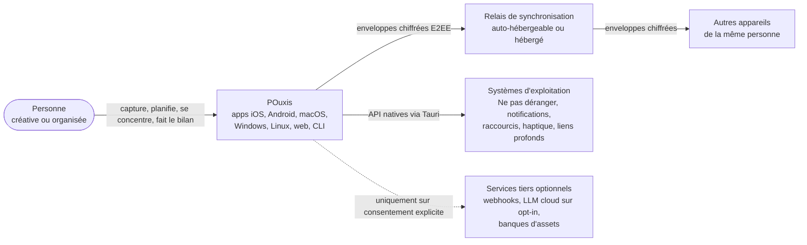
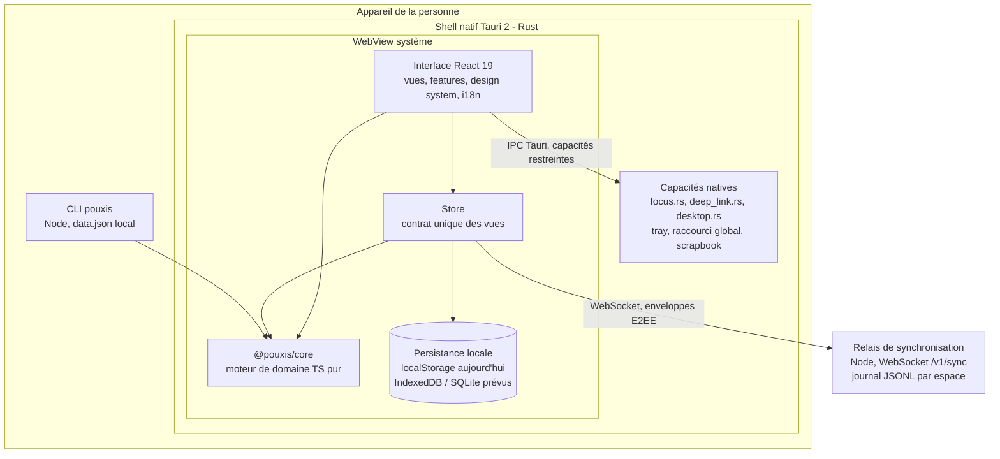
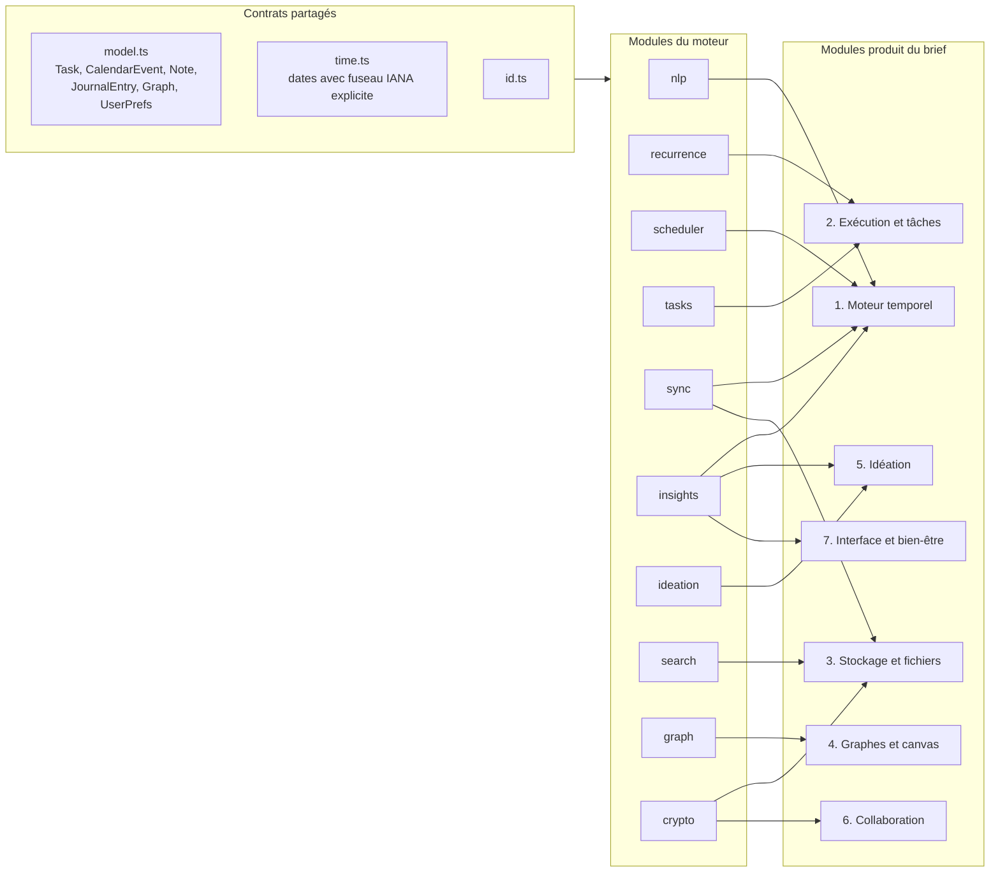
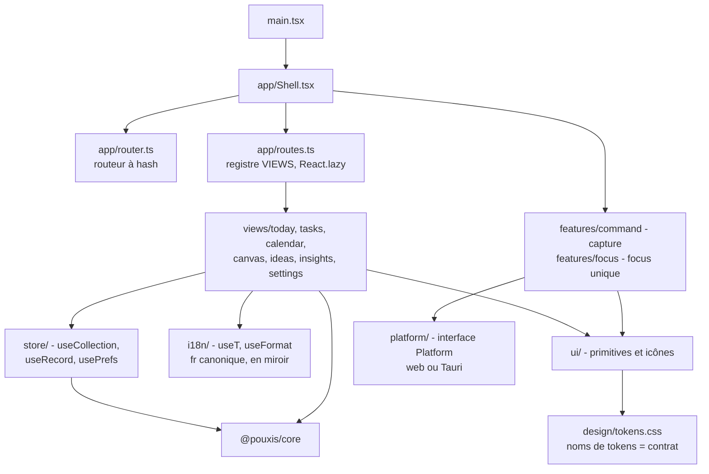
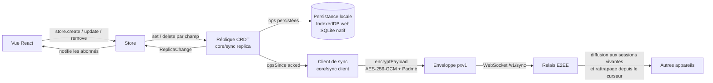
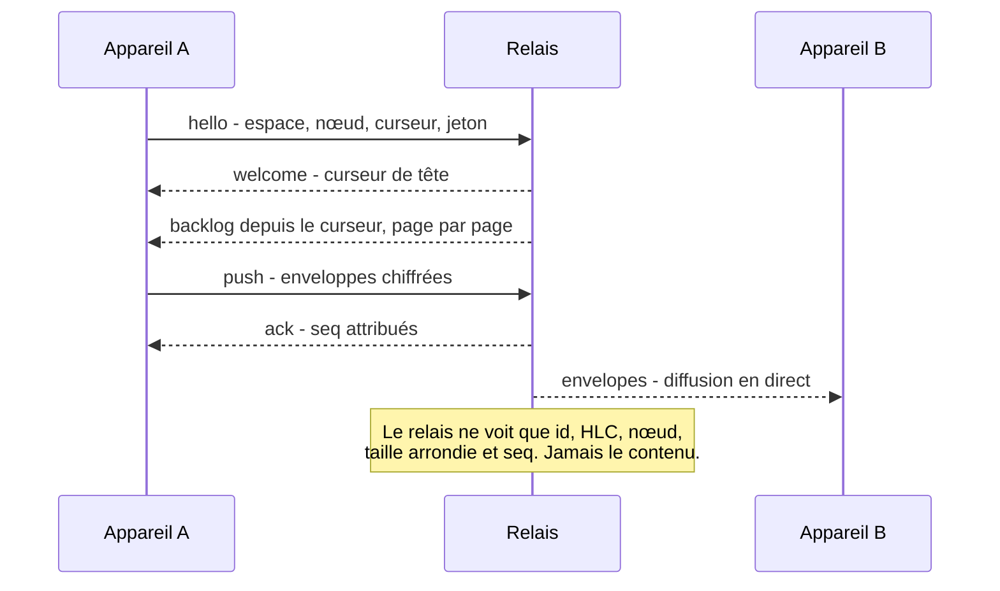

# Architecture de POuxis

> **État au 4 novembre 2026.** Ce document décrit l'architecture **réelle** du dépôt, en
> distinguant ce qui est **implémenté**, **en cours** et **prévu**. La feuille de route
> (`docs/product/ROADMAP.md`) reste la source de vérité du phasage ; les décisions structurantes
> sont consignées dans les ADR (`docs/adr/`). La sécurité est détaillée dans
> `docs/security/SECURITY_ARCHITECTURE.md` et `docs/security/THREAT_MODEL.md`.

## Sommaire

1. [Vue d'ensemble](#1-vue-densemble)
2. [Attributs de qualité et budgets](#2-attributs-de-qualité-et-budgets)
3. [Contexte (C4 niveau 1)](#3-contexte-c4-niveau-1)
4. [Conteneurs (C4 niveau 2)](#4-conteneurs-c4-niveau-2)
5. [Composants (C4 niveau 3)](#5-composants-c4-niveau-3)
6. [Flux de données](#6-flux-de-données)
7. [Sémantique des conflits](#7-sémantique-des-conflits)
8. [Évolution du schéma et migrations](#8-évolution-du-schéma-et-migrations)
9. [Sauvegarde et exportation (6.11)](#9-sauvegarde-et-exportation-611)
10. [Préoccupations transverses](#10-préoccupations-transverses)
11. [Matrice fonctionnalité → module → statut](#11-matrice-fonctionnalité--module--statut)
12. [Travaux futurs](#12-travaux-futurs)
13. [Écarts connus et dette assumée](#13-écarts-connus-et-dette-assumée)

**Légende des statuts** utilisée dans tout le document :

| Code | Signification                                                                              |
| ---- | ------------------------------------------------------------------------------------------ |
| ✅   | Implémenté : code présent, exporté par l'API publique du paquet, couvert par des tests.    |
| 🧩   | Moteur implémenté (`@pouxis/core`), interface utilisateur pas encore branchée.             |
| 🚧   | En cours : implémentation partielle ou provisoire.                                         |
| 🗓️   | Prévu : conçu ou phasé, aucun code.                                                        |
| 🔬   | Recherche : faisabilité, éthique ou légalité non établies (voir `ROADMAP.md` § Recherche). |

---

## 1. Vue d'ensemble

POuxis est une application **local-first** : chaque appareil détient une copie complète des
données de la personne, l'interface lit et écrit **localement et de façon synchrone**, et la
synchronisation est une tâche de fond qui fait converger les copies sans jamais bloquer
l'utilisateur. Le serveur est un **relais aveugle** : il stocke et redistribue des enveloppes
chiffrées de bout en bout, sans pouvoir les lire.

Le dépôt est un monorepo npm (workspaces) :

| Paquet              | Rôle                                                                                      | Technologie                                        |
| ------------------- | ----------------------------------------------------------------------------------------- | -------------------------------------------------- |
| `packages/core`     | `@pouxis/core` — moteur de domaine : modèle, temps, planification, tâches, CRDT, crypto…  | TypeScript pur, **zéro dépendance**, sans DOM/Node |
| `apps/pouxis`       | Client : interface React, design system, i18n, store ; shell natif Tauri 2 (`src-tauri/`) | React 19, Vite 8, CSS Modules, Rust (Tauri 2)      |
| `apps/sync-server`  | Relais de synchronisation WebSocket auto-hébergeable                                      | Node ≥ 22.18 (exécution directe du `.ts`)          |
| `apps/cli`          | Client en ligne de commande (3.15) : capture, liste, plan, export/import `.zip`           | Node ≥ 22.18                                       |
| `docs/`, `website/` | Documentation (FR) et site public                                                         | Markdown, HTML                                     |

Trois principes guident toutes les décisions :

1. **Le moteur est un contrat portable.** Toute la logique métier vit dans `@pouxis/core`,
   exécutable à l'identique dans la WebView, dans Node (CLI, serveur, tests) et demain dans un
   worker ou une autre interface (ADR 0005).
2. **L'interface ne connaît que l'interface `Store`.** La persistance (localStorage aujourd'hui,
   IndexedDB ou SQLite demain) et la synchronisation se remplacent sans toucher aux vues
   (ADR 0003).
3. **Rien ne quitte l'appareil en clair.** Chiffrement de bout en bout du contenu synchronisé,
   IA sur l'appareil d'abord, analytique locale et sur consentement (ADR 0004, 0007).

---

## 2. Attributs de qualité et budgets

Les budgets chiffrés sont ceux de `docs/product/MVP_SPEC.md` § 5, complétés par les cibles
d'architecture propres aux modules non couverts par le MVP. Ce sont des **cibles fixées par
l'équipe**, à mesurer sur des appareils de référence ; elles ne constituent pas des résultats
mesurés.

| Attribut               | Budget / exigence                                                                                                                    | Moyens architecturaux                                                                                                                                                                |
| ---------------------- | ------------------------------------------------------------------------------------------------------------------------------------ | ------------------------------------------------------------------------------------------------------------------------------------------------------------------------------------ |
| **Latence d'entrée**   | Retour visuel < 50 ms visé, ≤ 100 ms exigé (p95) ; analyse NLP 1.8 ≤ 5 ms par frappe ; brain dump (5.14) ≤ 50 ms visé, app résidente | Lectures synchrones du `Store` (`useSyncExternalStore`), aucune I/O réseau sur le chemin d'une frappe, moteur pur sans allocation d'objets DOM, calculs lourds déportables en worker |
| **Démarrage à froid**  | ≤ 1,5 s (p95) bureau, ≤ 2,5 s mobile jusqu'à la vue Aujourd'hui utilisable ; JS initial ≤ 250 Ko compressé                           | Vues découpées par `React.lazy` (ADR 0009), core sans dépendances, chargement des données locales avant tout réseau                                                                  |
| **Fluidité**           | Animations à 60 i/s, `transform`/`opacity` uniquement ; canvas 60 i/s partout, 120 i/s sur écrans à haute fréquence (4.1)            | Tokens `--dur-*`, `prefers-reduced-motion` ; canvas : quadtree pour le culling, layout force-directed hors du fil principal, rendu GPU à terme (ADR 0006)                            |
| **Routage**            | 1.1 sur 200 tâches / 14 jours / 100 événements ≤ 100 ms sur le fil principal, sinon worker                                           | `scheduler.route` est pur et déterministe : déplaçable en worker sans changement d'API                                                                                               |
| **Hors-ligne d'abord** | Toutes les fonctions du MVP fonctionnent sans réseau ; convergence ≤ 5 s après reconnexion pour 1 000 opérations (4G)                | Réplique CRDT locale, outbox reconstruite depuis l'état, protocole delta compact (3.11)                                                                                              |
| **Vie privée**         | Zéro télémétrie distante ; contenu chiffré de bout en bout sur le relais ; IA locale par défaut                                      | E2EE AES-256-GCM, bourrage Padmé, analytique locale non synchronisée (MVP_SPEC § 6)                                                                                                  |
| **Portabilité**        | iOS, Android, macOS, Windows, Linux, web ; export complet lisible (6.11, RGPD art. 20)                                               | Tauri 2 + WebView système (ADR 0001), core TS pur, format d'export JSON documenté                                                                                                    |
| **Mémoire**            | ≤ 200 Mo au repos sur bureau                                                                                                         | WebView système (pas de Chromium embarqué), pas de duplication des gros fichiers (3.8 par pointeurs)                                                                                 |
| **Accessibilité**      | WCAG 2.2 AA, cibles ≥ 44 px, navigation clavier complète                                                                             | Primitives `src/ui` accessibles par construction, tests de contraste des tokens (`contrast.test.ts`)                                                                                 |

---

## 3. Contexte (C4 niveau 1)



Les flèches en pointillés sont **prévues** (🗓️) et désactivées par défaut.

---

## 4. Conteneurs (C4 niveau 2)



| Conteneur       | Statut | Remarques                                                                                                                                                                                                     |
| --------------- | ------ | ------------------------------------------------------------------------------------------------------------------------------------------------------------------------------------------------------------- |
| Interface React | 🚧     | Shell, routeur à hash, registre des vues, design system, i18n et primitives UI en place ; les sept vues (`src/views/*`) sont encore des squelettes, construits au sprint 2.                                   |
| Store           | 🚧     | Contrat `Store` stable (`src/store/types.ts`). Implémentation actuelle : mémoire + `localStorage` (`memory.ts`), explicitement provisoire. Implémentation CRDT + IndexedDB/SQLite prévue (ADR 0003).          |
| `@pouxis/core`  | ✅     | Les dix modules (`scheduler`, `tasks`, `sync`, `crypto`, `insights`, `ideation`, `search`, `nlp`, `recurrence`, `graph`) exposent leur API publique par leur `index.ts` et sont couverts par des tests.       |
| Shell Tauri 2   | ✅     | Focus OS (1.11) honnête par OS, liens profonds `pouxis://` (1.13), tray, raccourci global (2.11), fenêtre scrapbook (5.6), haptique mobile (7.7), instance unique, mémorisation de la géométrie des fenêtres. |
| Relais de sync  | ✅     | Protocole v1, jetons HMAC à rotation, stockage fichier JSONL durable avec récupération, limitation de débit, métriques, Docker/Compose. Ne lit jamais les charges utiles.                                     |
| CLI             | ✅     | Fichier `$POUXIS_HOME/data.json` versionné avec concurrence optimiste et verrou ; export/import `.zip` (writer/reader ZIP maison, CRC32).                                                                     |

---

## 5. Composants (C4 niveau 3)

### 5.1 `@pouxis/core` — modules du moteur et modules produit

Les contrats partagés (`model.ts`, `time.ts`, `id.ts`) sont importés par tous les modules ;
aucun module n'importe l'interface ni une API de plateforme. Chaque module expose son API par
`src/<module>/index.ts` et est réexporté en namespace (`scheduler.route(...)`).



| Module       | Fonctions du brief                        | Contenu principal                                                                                                                                             | Statut |
| ------------ | ----------------------------------------- | ------------------------------------------------------------------------------------------------------------------------------------------------------------- | ------ |
| `scheduler`  | 1.1, 1.2, 1.6, 1.9, 1.10, 1.14, 1.15      | `route`, `propagateDelay`, `insertBuffers`, `magnetize`, `snapshot`/`compareSnapshots`, `progress`, garde maker schedule                                      | ✅     |
| `tasks`      | 2.1, 2.2, 2.3, 2.4, 2.6, 2.8, 2.12, 2.15  | dépendances, décomposition heuristique et modèles, decay, Eisenhower, Pomodoro, moteur de formules, Kanban, limite WIP                                        | ✅     |
| `sync`       | 1.7, 3.3, 3.11                            | HLC, réplique LWW par champ, tombstones, documents par blocs avec historique, index fractionnaires, diff texte, codec compact, protocole, client              | ✅     |
| `crypto`     | 3.5, 3.10, 6.5                            | AES-256-GCM `pxv1`, KDF, coffres, clé de récupération, charges utiles de sync avec Padmé, liens de partage, journal d'audit chaîné                            | ✅     |
| `insights`   | 1.3, 3.9, 5.15, 7.2, 7.3, 7.5, 7.9        | heatmap d'énergie, équilibre création/organisation, séries avec jokers, bilan hebdomadaire, culs-de-sac et archivage, arbre de compétences                    | ✅     |
| `ideation`   | 5.1, 5.2, 5.4, 5.10                       | connecteur aléatoire, palette d'images, contraintes divergentes, cartes de méthodes ; RNG déterministe (`mulberry32`)                                         | ✅     |
| `search`     | 3.2, 3.14, 5.8                            | BM25F lexical, recherche hybride RRF avec `Embedder` enfichable, backlinks, exclusion du bac à sable                                                          | ✅     |
| `nlp`        | 1.8, 2.7 (texte), 2.11                    | `parse` FR/EN (dates, heures, durées, échéances, participants, tags, priorité, récurrence, mode), `cleanTranscript`/`splitActions` (texte dicté), `inferMode` | 🧩     |
| `recurrence` | 2.9                                       | `parseRule` (littéral FR/EN, cron, RRULE) → `RecurrenceRule`, `occurrences`/`next` dans un fuseau IANA explicite, `describe`, `toRRule`                       | 🧩     |
| `graph`      | 4.1, 4.2, 4.3, 4.5, 4.9, 4.11, 4.13, 4.15 | quadtree, force-directed, arbre Buchheim-Walker, hiérarchie, repli, timeline, flux conditionnels, viewport, outline/OPML/SVG, tâches → graphe                 | 🧩     |

### 5.2 `apps/pouxis` — client



### 5.3 Shell Tauri 2

| Fichier Rust    | Rôle                                                                                                                                   |
| --------------- | -------------------------------------------------------------------------------------------------------------------------------------- |
| `lib.rs`        | Point d'entrée partagé bureau/mobile, enregistrement des plugins (instance unique en premier, puis deep-link, notifications, OS).      |
| `focus.rs`      | 1.11 implémenté honnêtement par OS : Raccourcis macOS installés par la personne, `gsettings` GNOME, repli interne sous Windows et iOS. |
| `deep_link.rs`  | File des liens `pouxis://` reçus avant que l'interface soit prête (1.13).                                                              |
| `desktop.rs`    | Tray (Capturer / Aujourd'hui / Quitter), raccourci global de capture (2.11), fenêtre scrapbook `#/scrapbook` (5.6).                    |
| `events.rs`     | Noms d'événements IPC partagés avec l'interface.                                                                                       |
| `capabilities/` | Capacités Tauri par fenêtre et par plateforme (`default`, `desktop`, `mobile`, `overlays`) : principe du moindre privilège.            |

`withGlobalTauri` est désactivé et une CSP est définie dans `tauri.conf.json` : l'interface
n'accède qu'aux commandes explicitement autorisées.

### 5.4 Relais de synchronisation

`config.ts` (configuration par variables d'environnement), `token.ts` (jetons d'espace HMAC,
vérification en temps constant avant tout parsing, rotation des secrets), `protocol.ts`
(miroir serveur de `core/sync/protocol.ts`), `relay.ts` (sessions, espaces, ordre et diffusion),
`storage/` (`memory.ts` pour les tests, `file.ts` : un journal JSONL append-only par espace,
`fdatasync` configurable, récupération sur dernière ligne tronquée), `rate-limit.ts`,
`metrics.ts`, `logger.ts`.

---

## 6. Flux de données

### 6.1 Chemin d'une écriture



Statut de chaque maillon :

| Maillon                                | Statut | Détail                                                                                                |
| -------------------------------------- | ------ | ----------------------------------------------------------------------------------------------------- |
| Vue → `Store`                          | ✅     | Hooks `useCollection`, `useRecord`, `usePrefs`, `useSyncStatus`.                                      |
| `Store` → réplique CRDT                | 🗓️     | Le store actuel écrit directement dans des `Map` ; le branchement sur `sync.createReplica` est prévu. |
| Réplique → persistance                 | 🗓️     | `localStorage` (clé `pouxis:v0`) en attendant IndexedDB (web) et SQLite (natif) — ADR 0003.           |
| Réplique → client de sync → enveloppes | ✅     | Dans le core : outbox coalescée par champ, reconstruite depuis l'état à chaque connexion.             |
| Chiffrement des enveloppes             | ✅     | `crypto.encryptPayload`, AAD = espace, id, HLC, nœud ; bourrage Padmé.                                |
| Transport WebSocket côté app           | 🗓️     | Le client est indépendant du transport ; l'adaptateur WebSocket de l'app reste à écrire.              |
| Relais                                 | ✅     | `apps/sync-server`.                                                                                   |

### 6.2 Protocole de synchronisation



Garanties du relais (`relay.ts`) : ajouts sérialisés par espace, chaque session voit les
enveloppes **dans l'ordre du journal et exactement une fois**, rattrapage paginé avec
contre-pression avant le passage au direct, aucune enveloppe renvoyée à son émetteur. Les
`push` sont **idempotents sur l'id d'enveloppe** : un renvoi après coupure est sans effet.

États du client : `offline → connecting → syncing → live`, `error` fatal sur jeton refusé
(pas de reconnexion avec le même jeton), reconnexion avec `backoff` exponentiel sinon.

---

## 7. Sémantique des conflits

Le modèle de convergence est détaillé et justifié dans l'ADR 0002. En résumé :

| Situation                                                              | Résultat                                                                                                   |
| ---------------------------------------------------------------------- | ---------------------------------------------------------------------------------------------------------- |
| Deux appareils modifient **des champs différents** d'un enregistrement | Les deux modifications sont conservées (LWW **par champ**, pas par enregistrement).                        |
| Deux appareils modifient **le même champ**                             | La valeur au plus grand HLC gagne ; égalité exacte (même nœud) départagée par l'ordre JSON canonique.      |
| Suppression concurrente d'une modification                             | La suppression (tombstone) gagne sur toute écriture, antérieure ou postérieure : pas de « résurrection ».  |
| Modifications concurrentes de **blocs différents** d'une note          | Fusion sans perte : chaque bloc est un enregistrement indépendant (3.3).                                   |
| Modifications concurrentes **du même bloc**                            | La dernière gagne ; toutes les versions observées restent dans l'historique du bloc et sont restaurables.  |
| Réordonnancement concurrent                                            | Index fractionnaires (`between`) : seul le `pos` du bloc déplacé est écrit ; tri stable par `pos` puis id. |
| Horloge d'un pair en avance                                            | Avance tolérée jusqu'à `maxDriftMs` (24 h par défaut) ; au-delà l'op est rejetée (`SyncError`).            |

Propriétés : `apply` est **idempotent, commutatif et associatif** (jointure de registres) ;
deux répliques ayant reçu le même ensemble d'ops ont le même état, quel que soit l'ordre ou
la duplication des livraisons.

**Conflits sémantiques** (hors CRDT). La convergence ne garantit pas la cohérence métier : un
créneau peut chevaucher un rendez-vous après fusion, une dépendance peut devenir circulaire.
Ces invariants sont **vérifiés après fusion par le moteur** (`tasks.detectCycles` signale les cycles,
`scheduler.route` re-planifie sans déplacer les éléments `pinned`) plutôt qu'empêchés à
l'écriture, ce qui est le seul choix compatible avec le hors-ligne.

---

## 8. Évolution du schéma et migrations

Trois niveaux de format évoluent indépendamment :

| Niveau                        | Versionnement                                                                                      | Règle                                                                                                                                                                                                                        |
| ----------------------------- | -------------------------------------------------------------------------------------------------- | ---------------------------------------------------------------------------------------------------------------------------------------------------------------------------------------------------------------------------- |
| **Modèle** (`model.ts`)       | Évolution **additive** uniquement entre versions mineures                                          | Un champ nouveau est **optionnel** ; un champ n'est jamais renommé ni retypé : on en ajoute un autre et on lit l'ancien en repli. Les répliques anciennes conservent et resynchronisent les champs inconnus (LWW par champ). |
| **Protocole** (`/v1/sync`)    | Chemin versionné (`v1`), préfixes d'enveloppe (`pxv1`, `pxk1`), format de codec (`[1, …]`)         | Un changement incompatible crée `/v2` ; le relais sert les deux pendant une période de transition annoncée.                                                                                                                  |
| **Fichiers locaux et export** | `schemaVersion` (`SCHEMA_VERSION = 1` dans la CLI), tag de format (`pouxis-data`, `pouxis-export`) | Toute montée de version ajoute une étape à `migrate()` ; un fichier plus récent que le logiciel est refusé (`too-new`), jamais réécrit.                                                                                      |

Les migrations sont des **fonctions pures du core**, testées avec des fixtures de chaque version
publiée, exécutées au chargement **avant** toute synchronisation. Une migration de données
synchronisées s'exprime comme des **ops CRDT ordinaires** (écritures de champs), ce qui la rend
idempotente si plusieurs appareils la jouent en même temps.

---

## 9. Sauvegarde et exportation (6.11)

Format portable (implémenté dans `apps/cli/src/archive/bundle.ts`, ✅ côté CLI) :

```
manifest.json          tag de format, version de schéma, comptes, liste des fichiers
prefs.json             UserPrefs
<collection>.json      un tableau JSON par collection (tasks, events, notes, journal, graphs)
notes/<slug>.md        chaque note lisible en Markdown avec front matter
README.md              description des fichiers, pour un humain
```

- Les **JSON font foi** ; les copies Markdown servent aux humains et aux autres outils et sont
  ignorées à l'import.
- L'archive est produite par un writer ZIP sans dépendance (`apps/cli/src/zip`), réutilisable
  dans l'app car il ne dépend que de `Uint8Array`.
- **Prévu (🗓️)** : bouton d'export dans Réglages (même format), export chiffré optionnel par
  phrase secrète, sauvegarde automatique périodique sur le bureau, et restauration depuis
  l'archive dans une **nouvelle** réplique (nouvel id de nœud) pour ne jamais rejouer l'identité
  d'un appareil.
- Un coffre chiffré (3.5) est exporté **chiffré** ; son en-tête public permet de le rouvrir avec
  la phrase secrète ou la clé de récupération.

---

## 10. Préoccupations transverses

### 10.1 Sécurité

Référence : `docs/security/SECURITY_ARCHITECTURE.md` (hiérarchie de clés, classification S0–S3,
choix cryptographiques) et `docs/security/THREAT_MODEL.md` (STRIDE par composant). Points
d'architecture :

- Toute la cryptographie passe par WebCrypto (`crypto.subtle`), y compris côté Node ; aucune
  primitive maison.
- Clés de coffre aléatoires, non extractibles ; changement de phrase secrète = ré-enveloppement
  de 32 octets.
- Shell Tauri : `withGlobalTauri: false`, CSP, capacités par fenêtre ; les plugins et
  intégrations futures passent par un bac à sable (ADR 0008).

### 10.2 Internationalisation

Clés typées, **français canonique**, anglais miroir, un fichier par namespace
(`src/i18n/fr/*.ts`) ; `useT()` et `useFormat()` (dates et nombres via `Intl`, toujours avec le
fuseau IANA des préférences). La CLI a son propre dictionnaire `fr`/`en`. Voir ADR 0010.

### 10.3 Accessibilité

WCAG 2.2 AA : primitives accessibles par construction dans `src/ui`, cibles tactiles ≥ 44 px,
focus visible, navigation clavier complète, contrastes vérifiés par test sur les tokens en
thèmes clair, sombre et E-Ink. Toute vue non textuelle (canvas, heatmap, spirale) doit offrir
une **alternative textuelle équivalente** (liste, tableau ou plan) — exigence d'architecture,
pas seulement de design.

### 10.4 Mouvement et performance

Animations limitées à `transform` et `opacity`, durées par tokens `--dur-*` (`motion.css`),
`prefers-reduced-motion` respecté partout. Calculs du moteur purs et synchrones, déplaçables en
Web Worker si le budget est dépassé. Pour le canvas : culling par quadtree, simulation de forces
pas à pas, rendu GPU à terme (ADR 0006).

### 10.5 Observabilité locale et sur opt-in

- **Client** : aucune télémétrie distante. Événements de comportement anonymes stockés **sur
  l'appareil**, non synchronisés, 90 jours glissants, effaçables (`MVP_SPEC.md` § 6). Export
  volontaire d'un rapport lisible, relu par la personne avant envoi.
- **Diagnostics** : journal local des erreurs, exportable sur demande pour un rapport de bug,
  sans contenu utilisateur.
- **Relais** : journaux structurés (`logger.ts`) sans charge utile, métriques agrégées
  (`metrics.ts`) pour l'opérateur ; aucune donnée de contenu, le relais n'en possède pas.

### 10.6 Pyramide de tests

| Niveau              | Outil                            | Portée                                                                                                                                       |
| ------------------- | -------------------------------- | -------------------------------------------------------------------------------------------------------------------------------------------- |
| Unitaires du moteur | Vitest, `TZ=UTC`                 | Base large : chaque module de `@pouxis/core`, fixtures déterministes, fuseaux explicites.                                                    |
| Propriétés CRDT     | Vitest                           | Idempotence, commutativité, associativité de `apply` sur des séquences d'ops mélangées et dupliquées (à généraliser en tests de propriétés). |
| Composants          | Vitest + jsdom + Testing Library | Primitives `src/ui`, i18n (complétude des dictionnaires), contrastes des tokens.                                                             |
| Intégration serveur | Vitest (`apps/sync-server/test`) | Protocole, jetons, stockage (récupération après écriture tronquée), serveur WebSocket réel.                                                  |
| Bout en bout        | Playwright (Chromium)            | Prévu : parcours MVP F1–F4 sur le client web (`apps/pouxis/e2e`, job CI déjà prêt), puis deux clients synchronisés via un relais local.      |
| Natif               | CI `rust.yml`, `mobile.yml`      | Compilation et lint Rust, builds mobiles.                                                                                                    |

### 10.7 Gestion des erreurs

- Le core lève des erreurs **typées et codées** (`SyncError`/`SyncErrorCode`,
  `CryptoError`/`CryptoErrorCode`, `SchemaError` côté CLI) ; les fonctions de domaine retournent
  des résultats explicites plutôt que d'échouer (`MoveResult`/`MoveRefusal`, `WipCheck`).
- L'interface traduit un code en message i18n (`i18n/fr/errors.ts`) : jamais de message technique
  brut affiché.
- Une écriture locale ne peut pas échouer pour une raison réseau ; seules la validation et le
  stockage local plein sont remontés à la personne.
- Le relais refuse plutôt que de corriger : un journal corrompu hors dernière ligne est signalé
  (`StorageCorruptError`), jamais tronqué silencieusement.

### 10.8 Drapeaux de fonctionnalités

Pas de service distant de feature flags (incompatible avec le hors-ligne et la vie privée).
Prévu (🗓️) : drapeaux **compilés** pour les fonctions expérimentales (exclues des builds de
production tant qu'elles ne sont pas prêtes) et **préférences locales** pour les fonctions
optionnelles visibles (routage automatique, fondu de l'interface, haptique), stockées dans
`UserPrefs` et donc synchronisées entre les appareils de la personne.

---

## 11. Matrice fonctionnalité → module → statut

Statuts au 4 novembre 2026 (légende en tête de document). « UI » indique que l'interface
correspondante est prévue au sprint 2 (vues de l'application).

### Module 1 — Moteur temporel et calendrier

| ID   | Fonction                        | Module(s)                    | Statut                                                     |
| ---- | ------------------------------- | ---------------------------- | ---------------------------------------------------------- |
| 1.1  | Routage dynamique               | `scheduler.route`            | 🧩                                                         |
| 1.2  | Propagation des retards         | `scheduler.propagateDelay`   | 🧩                                                         |
| 1.3  | Heatmap d'énergie               | `insights` (energy)          | 🧩                                                         |
| 1.4  | Vue en spirale                  | vue `calendar`               | 🔬                                                         |
| 1.5  | Multi-fuseaux collaborateurs    | `time.ts`, vue `calendar`    | 🗓️                                                         |
| 1.6  | Buffers                         | `scheduler.insertBuffers`    | 🧩                                                         |
| 1.7  | Synchronisation CRDT            | `sync`, relais               | 🚧 (moteur et relais ✅, branchement app 🗓️)               |
| 1.8  | Analyseur NLP                   | `nlp.parse`                  | 🧩                                                         |
| 1.9  | Snapshot prévu / réalisé        | `scheduler.snapshot`         | 🧩                                                         |
| 1.10 | Tâches flottantes               | `scheduler.magnetize`        | 🧩                                                         |
| 1.11 | Hyperfocus OS                   | `focus.rs`, `platform`       | ✅ (macOS, GNOME) ; repli interne Windows/iOS ; Android 🗓️ |
| 1.12 | Estimations de trajet           | —                            | 🗓️                                                         |
| 1.13 | Liens profonds d'événements     | `deep_link.rs`, `app/router` | ✅                                                         |
| 1.14 | Barre de progression temporelle | `scheduler.progress`         | 🧩                                                         |
| 1.15 | Protection maker schedule       | `scheduler` (maker)          | 🧩                                                         |

### Module 2 — Exécution et tâches

| ID   | Fonction                     | Module(s)                                          | Statut                                    |
| ---- | ---------------------------- | -------------------------------------------------- | ----------------------------------------- |
| 2.1  | Graphe de dépendances        | `tasks` (dependencies)                             | 🧩                                        |
| 2.2  | Décomposition en sous-tâches | `tasks` (decompose : heuristique, modèles) ; IA 🗓️ | 🧩                                        |
| 2.3  | Usure des tâches             | `tasks.decay`                                      | 🧩                                        |
| 2.4  | Eisenhower calculée          | `tasks` (eisenhower)                               | 🧩                                        |
| 2.5  | Tags géolocalisés            | `model` (`GeoTrigger`), `platform`                 | 🗓️                                        |
| 2.6  | Pomodoro par tâche           | `tasks` (pomodoro), `features/focus`               | 🧩                                        |
| 2.7  | Parser vocal                 | `nlp` (texte dicté), sidecar STT (ADR 0007)        | 🧩 (post-traitement du texte) ; STT 🗓️    |
| 2.8  | Champs à formules            | `tasks` (formula)                                  | 🧩                                        |
| 2.9  | Récurrence cron / littérale  | `recurrence`                                       | 🧩                                        |
| 2.10 | Tâches depuis le mail        | relais étendu                                      | 🗓️                                        |
| 2.11 | Capture universelle          | `desktop.rs`, `features/command`                   | 🚧 (raccourci natif ✅, UI de capture 🗓️) |
| 2.12 | Vues Kanban                  | `tasks` (kanban)                                   | 🧩                                        |
| 2.13 | Délégation par webhook       | serveur auto-hébergeable                           | 🗓️                                        |
| 2.14 | Focus unique                 | `features/focus`                                   | 🗓️                                        |
| 2.15 | Limite WIP                   | `tasks` (wip)                                      | 🧩                                        |

### Module 3 — Stockage, fichiers et multi-plateforme

| ID   | Fonction                         | Module(s)                        | Statut                            |
| ---- | -------------------------------- | -------------------------------- | --------------------------------- |
| 3.1  | Local-first                      | `store`, `sync`                  | 🚧 (contrat ✅, store provisoire) |
| 3.2  | Recherche sémantique             | `search` (hybrid, `Embedder`)    | 🧩 (aucun modèle embarqué)        |
| 3.3  | Versioning par bloc              | `sync` (blocks)                  | 🧩                                |
| 3.4  | OCR côté client                  | ADR 0007                         | 🗓️                                |
| 3.5  | Coffres E2EE                     | `crypto` (vault, recovery)       | 🧩                                |
| 3.6  | Compression asymétrique          | —                                | 🗓️                                |
| 3.7  | Aperçus universels WASM          | —                                | 🗓️                                |
| 3.8  | Indexation des disques           | shell Tauri (bureau)             | 🗓️                                |
| 3.9  | Archivage automatique            | `insights` (lifecycle)           | 🧩                                |
| 3.10 | Partage par lien                 | `crypto` (share) ; service 🗓️    | 🧩                                |
| 3.11 | Sync basse bande passante        | `sync` (codec, outbox coalescée) | ✅                                |
| 3.12 | Share sheets, glisser-déposer OS | extensions natives               | 🗓️                                |
| 3.13 | Métadonnées audio                | —                                | 🗓️                                |
| 3.14 | Backlinks                        | `search` (links)                 | 🧩                                |
| 3.15 | Client CLI                       | `apps/cli`                       | ✅                                |

### Module 4 — Organigrammes, graphes et spatialisation

| ID   | Fonction                        | Module(s)                          | Statut                                      |
| ---- | ------------------------------- | ---------------------------------- | ------------------------------------------- |
| 4.1  | Canvas infini 10 000 nœuds      | `graph` (quadtree), vue `canvas`   | 🧩 (index spatial, viewport ; rendu GPU 🗓️) |
| 4.2  | Layout force-directed           | `graph` (force)                    | 🧩                                          |
| 4.3  | Transmutation liste → arbre     | `graph` (from-tasks, tree)         | 🧩                                          |
| 4.4  | Nœuds enrichis                  | plugins (ADR 0008)                 | 🗓️                                          |
| 4.5  | Organigramme temporel           | `graph` (timeline)                 | 🧩                                          |
| 4.6  | Stylet                          | vue `canvas`                       | 🗓️                                          |
| 4.7  | Logique conditionnelle des flux | `model` (`EdgeCondition`), `graph` | 🧩                                          |
| 4.8  | Squelette par IA                | ADR 0007                           | 🗓️                                          |
| 4.9  | Collapsibilité                  | `graph` (hierarchy)                | 🧩                                          |
| 4.10 | Présentation caméra dynamique   | `graph` (viewport), vue `canvas`   | 🗓️ (maths de viewport 🧩)                   |
| 4.11 | Export multi-formats            | `graph` (hierarchy → OPML/SVG)     | 🧩                                          |
| 4.12 | Templates UML / BPMN / cloud    | —                                  | 🗓️                                          |
| 4.13 | Minimap                         | `graph` (quadtree, geometry)       | 🧩                                          |
| 4.14 | Multi-curseurs                  | canal de présence (§ 12)           | 🗓️                                          |
| 4.15 | Extraction graphe → texte       | `graph` (hierarchy)                | 🧩                                          |

### Module 5 — Idéation et outils créatifs

| ID   | Fonction                    | Module(s)                        | Statut                              |
| ---- | --------------------------- | -------------------------------- | ----------------------------------- |
| 5.1  | Moteur de sérendipité       | `ideation` (connection)          | 🧩                                  |
| 5.2  | Moodboard paramétrique      | `ideation` (palette)             | 🧩                                  |
| 5.3  | Machine à écrire stricte    | éditeur                          | 🗓️                                  |
| 5.4  | Contraintes divergentes     | `ideation` (constraints)         | 🧩                                  |
| 5.5  | Journal de friction         | `model` (`JournalEntry`)         | 🗓️                                  |
| 5.6  | Scrapbook flottant          | `desktop.rs`                     | 🚧 (fenêtre native ✅, vue 🗓️)      |
| 5.7  | Tagging d'intonation vocale | —                                | 🔬 (règlement (UE) 2024/1689)       |
| 5.8  | Bac à sable                 | `search` (exclusion)             | 🧩                                  |
| 5.9  | Banques d'assets            | plugins                          | 🗓️                                  |
| 5.10 | Cartes de méthodes          | `ideation` (methods)             | 🧩                                  |
| 5.11 | Éditeur Markdown hybride    | `sync` (markdown, blocks)        | 🚧 (modèle de blocs ✅, éditeur 🗓️) |
| 5.12 | Prompts visuels             | —                                | 🗓️                                  |
| 5.13 | Ambiance sonore générative  | Web Audio                        | 🗓️                                  |
| 5.14 | Brain dump < 50 ms          | `features/command`, `desktop.rs` | 🗓️                                  |
| 5.15 | Détecteur de culs-de-sac    | `insights` (lifecycle)           | 🧩                                  |

### Module 6 — Collaboration et écosystème

| ID   | Fonction                         | Module(s)                       | Statut               |
| ---- | -------------------------------- | ------------------------------- | -------------------- |
| 6.1  | Webhooks sortants                | serveur auto-hébergeable (§ 12) | 🗓️                   |
| 6.2  | API GraphQL                      | serveur auto-hébergeable (§ 12) | 🗓️                   |
| 6.3  | Plugins « / »                    | ADR 0008                        | 🗓️                   |
| 6.4  | Commentaires par blocs           | `sync` (blocks)                 | 🗓️                   |
| 6.5  | Audit trail                      | `crypto` (audit)                | 🧩                   |
| 6.6  | Statuts vidéo                    | —                               | 🗓️                   |
| 6.7  | Permissions par héritage         | —                               | 🗓️                   |
| 6.8  | Boîte de réception d'équipe      | —                               | 🗓️                   |
| 6.9  | Graphe de connaissances social   | —                               | 🔬 (profilage, RGPD) |
| 6.10 | Sondages pondérés                | —                               | 🗓️                   |
| 6.11 | Export standardisé `.zip`        | `apps/cli` (archive, zip)       | 🚧 (CLI ✅, app 🗓️)  |
| 6.12 | Mentions contextualisées par IA  | ADR 0007                        | 🗓️                   |
| 6.13 | Canaux vocaux éphémères          | —                               | 🗓️                   |
| 6.14 | SSO SAML / OAuth2                | serveur auto-hébergeable        | 🗓️                   |
| 6.15 | Modèles d'espaces communautaires | export/import (§ 9)             | 🗓️                   |

### Module 7 — Interface, bien-être et télémétrie personnelle

| ID   | Fonction                        | Module(s)                         | Statut                 |
| ---- | ------------------------------- | --------------------------------- | ---------------------- |
| 7.1  | Moteur d'interface Rust/WASM    | piste de recherche (§ 12)         | 🔬                     |
| 7.2  | Équilibre création/organisation | `insights` (balance)              | 🧩                     |
| 7.3  | Séries sans culpabilisation     | `insights` (streak)               | 🧩                     |
| 7.4  | Interface zen (auto-fading)     | `app/Shell`, `design/motion.css`  | 🗓️                     |
| 7.5  | Arbre de compétences            | `insights` (skills)               | 🧩                     |
| 7.6  | Palette selon soleil / météo    | `design` (thème automatique)      | 🚧 (soleil) ; météo 🗓️ |
| 7.7  | Retour haptique                 | `platform`, plugin haptics mobile | ✅                     |
| 7.8  | Remapping clavier absolu        | —                                 | 🗓️                     |
| 7.9  | Bilan hebdomadaire              | `insights` (review)               | 🧩                     |
| 7.10 | Thème E-Ink                     | `design/tokens.css` (`eink`)      | ✅ (tokens)            |

---

## 12. Travaux futurs

### 12.1 Bac à sable de plugins (6.3)

Plugins communautaires exécutés **hors du contexte de l'application** : iframe `sandbox` sans
`allow-same-origin` (web et WebView), communication par `postMessage` avec un protocole de
messages typé et versionné, **capacités déclarées dans un manifeste** et accordées par la
personne (lecture d'une collection, insertion de bloc, réseau vers des domaines listés). Aucun
accès direct au `Store`, au réseau ni aux clés. Détails et alternatives : ADR 0008.

### 12.2 Serveur auto-hébergeable : GraphQL (6.2) et webhooks (6.1, 2.13)

Le relais actuel est aveugle par construction ; une API qui **lit** les données ne peut donc
pas vivre dans le relais. Architecture retenue : un **compagnon optionnel**, déployé par la
personne ou son organisation, qui détient une clé de l'espace (comme un appareil
supplémentaire), maintient une réplique déchiffrée et expose :

- une API GraphQL en lecture/écriture, authentifiée par jetons à portée limitée, traduite en ops
  CRDT ordinaires ;
- des webhooks sortants signés (HMAC), avec liste blanche de destinations, nouvelles tentatives
  bornées et protection SSRF (voir THREAT_MODEL § 3.8 et § 3.9).

Ce choix préserve la promesse E2EE pour qui n'active pas le compagnon, et rend explicite que
l'activer revient à faire confiance à ce serveur.

### 12.3 IA sur l'appareil d'abord (ADR 0007)

| Fonction             | Approche envisagée                                                                                                                                                      |
| -------------------- | ----------------------------------------------------------------------------------------------------------------------------------------------------------------------- |
| Embeddings (3.2)     | Petit modèle de phrases via ONNX Runtime Web (WebGPU, repli WASM), branché sur l'interface `Embedder` déjà définie ; vecteurs persistés par `exportVectors()`.          |
| OCR (3.4)            | API natives quand elles existent (Vision sur Apple, ML Kit sur Android, `Windows.Media.Ocr`) ; repli WASM sur Linux et web.                                             |
| Transcription (2.7)  | whisper.cpp comme **sidecar** Tauri sur bureau ; API de reconnaissance vocale de l'OS sur mobile.                                                                       |
| LLM (2.2, 4.8, 6.12) | Modèle local quand l'appareil le permet ; **LLM cloud uniquement sur opt-in explicite**, par fonction, avec clé fournie par la personne et aperçu de ce qui est envoyé. |

### 12.4 Canvas WebGL / WebGPU (4.1)

Rendu actuel visé : SVG/DOM pour les petits graphes (accessibilité native). Au-delà d'un seuil
mesuré, bascule vers un rendu GPU (WebGL 2, WebGPU quand disponible dans les WebView cibles),
alimenté par le quadtree du core et doublé d'un arbre d'accessibilité DOM hors écran. Voir
ADR 0006.

### 12.5 Moteur d'interface Rust/WASM (7.1) — piste de recherche mesurée

Pas de réécriture. Raisons :

- le coût de latence d'une interaction POuxis est dominé par le rendu et la mise en page de la
  WebView, que WASM ne contourne pas : une interface Rust/WASM dessine toujours via le DOM ou un
  canvas ;
- une réécriture invaliderait le core TypeScript testé, partagé par la CLI et le relais ;
- le gain n'est pas démontré pour ce produit.

Démarche : **mesurer d'abord** (traces de performance sur appareils de référence), puis porter
en Rust/WASM uniquement les **noyaux de calcul** qui dépassent leur budget (simulation de
forces, routage sur de grands volumes), derrière la même API TypeScript, et comparer.

### 12.6 Présence temps réel (4.14)

Canal **éphémère et séparé** des ops CRDT : messages de position chiffrés avec la clé de
l'espace, relayés sans persistance, à faible fréquence et interpolés côté client. La présence
ne doit jamais entrer dans le journal de l'espace (volume, et fuite de métadonnées
comportementales).

---

## 13. Écarts connus et dette assumée

| Écart                                                 | Conséquence                                                          | Résolution prévue                                                                            |
| ----------------------------------------------------- | -------------------------------------------------------------------- | -------------------------------------------------------------------------------------------- |
| Store en mémoire + `localStorage`, sans réplique CRDT | Pas de sync ni d'historique dans l'app ; quota `localStorage` limité | Store CRDT + IndexedDB/SQLite (ADR 0003)                                                     |
| Vues à l'état de squelette                            | Fonctions moteur 🧩 invisibles pour la personne                      | Sprint 2                                                                                     |
| PBKDF2 plutôt qu'Argon2id                             | Résistance moindre aux attaques GPU hors ligne                       | ADR-SEC-001 (`SECURITY_ARCHITECTURE.md` § 4.1)                                               |
| Relais mono-processus, stockage fichier               | Pas de haute disponibilité                                           | Suffisant pour l'auto-hébergement ; interface `storage/types.ts` prête pour d'autres moteurs |
| Compaction du journal du relais non implémentée       | Croissance continue du journal d'un espace                           | Instantané chiffré produit par un client + troncature                                        |
