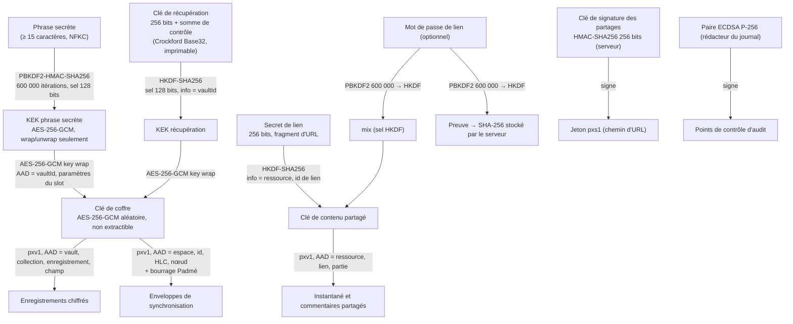

# Architecture de sécurité de POuxis

> Statut : version 0.1 — s'applique au module `@pouxis/core/crypto` (`packages/core/src/crypto/`).
> Document compagnon : [modèle de menaces](./THREAT_MODEL.md). Politique de divulgation :
> [`SECURITY.md`](../../SECURITY.md).

POuxis est une application _local-first_ : la source de vérité est l'appareil de l'utilisateur.
Le serveur de synchronisation est un **relais** qui ordonne et redistribue des enveloppes
chiffrées ; il n'a jamais besoin de lire le contenu. Ce document décrit la hiérarchie de clés,
la classification des données, les choix cryptographiques et les réglages par défaut attendus
de chaque module.

## 1. Principes

1. **Primitives standard uniquement**, via WebCrypto (`globalThis.crypto.subtle`), disponible à
   l'identique dans les navigateurs, dans les WebViews de Tauri 2 et dans Node ≥ 22. Aucune
   cryptographie écrite à la main, aucune dépendance.
2. **Le serveur ne détient aucun secret de déchiffrement.** Les clés de coffre, de partage et de
   récupération ne quittent l'appareil que sous forme enveloppée (_wrapped_).
3. **Tout est authentifié.** Chiffrement AEAD exclusivement ; chaque texte chiffré est lié par
   ses données associées (AAD) à l'endroit où il vit.
4. **Formats versionnés** (`pxv1`, `pxk1`, `pxs1`, `pouxis/audit/v1`) : on peut faire évoluer un
   algorithme sans ambiguïté ni réinterprétation d'un format par un autre.
5. **Entrées non fiables validées strictement** : en-têtes de coffre, jetons de partage et
   journaux d'audit sont reparsés champ par champ ; les paramètres de coût hors bornes sont
   refusés _avant_ tout calcul.
6. **Échecs uniformes** : une mauvaise clé, une AAD différente et une altération produisent la
   même erreur (`decrypt-failed`, `unlock-failed`), sans indiquer laquelle.

## 2. Hiérarchie de clés



Points clés :

- **La clé de coffre est aléatoire**, jamais dérivée de la phrase secrète. Changer de phrase
  secrète (`changeVaultPassphrase`) ne réenveloppe que 32 octets : aucune donnée n'est
  rechiffrée. Le même chemin, avec la clé de récupération comme justificatif, sert à la
  réinitialisation en cas d'oubli.
- **L'en-tête de coffre (`VaultHeader`) est public et synchronisable** : il ne contient que des
  sels, des paramètres de dérivation et des clés enveloppées. Les paramètres de chaque slot font
  partie de l'AAD de l'enveloppe : un relais malveillant ne peut ni affaiblir les itérations ni
  substituer la clé enveloppée d'un autre coffre.
- **La clé déverrouillée est un `CryptoKey` non extractible** : le code de la page peut
  l'utiliser tant que le coffre est ouvert, mais ne peut pas en lire les octets. Fermer le coffre
  consiste à abandonner la référence (et à vider les caches de texte clair côté interface).
- **La clé de récupération** n'est affichée qu'une fois et n'est jamais stockée par POuxis. Sa
  somme de contrôle de 24 bits ne sert qu'à détecter les fautes de frappe. `rotateRecoveryKey`
  la remplace, `removeRecoveryKey` la supprime (au prix de toute possibilité de récupération).

## 3. Classification des données

| Classe                               | Exemples                                                                                             | Où elle peut exister                                                                 | Protection                                                                              |
| ------------------------------------ | ---------------------------------------------------------------------------------------------------- | ------------------------------------------------------------------------------------ | --------------------------------------------------------------------------------------- |
| **S3 — Secrets**                     | phrase secrète, clé de récupération, clé de coffre en clair, secret de lien, mot de passe de partage | mémoire de l'appareil uniquement (phrase et clé de récupération : jamais persistées) | `CryptoKey` non extractibles, `zeroize` des tampons, jamais journalisés, jamais envoyés |
| **S2 — Contenu utilisateur**         | notes, tâches, événements, pièces jointes, commentaires de partage                                   | appareil (stockage local), relais et liens de partage sous forme chiffrée            | AES-256-GCM `pxv1` avec AAD de localisation                                             |
| **S1 — Métadonnées opérationnelles** | id d'espace, id d'enveloppe, HLC, id de nœud, taille (arrondie), heure de connexion, adresse IP      | relais, journaux serveur                                                             | minimisation, bourrage Padmé, rétention courte côté serveur                             |
| **S0 — Public**                      | en-tête de coffre, claims d'un jeton de partage, clé publique de point de contrôle                   | partout                                                                              | intégrité (AAD, HMAC, signatures) ; aucune confidentialité requise                      |

Le **journal d'audit** relève de S2 (il peut révéler qui a fait quoi) ; son contenu doit rester
minimal (`details` sans données personnelles inutiles, RGPD art. 5(1)(c)).

## 4. Choix cryptographiques

| Usage                                   | Choix                                                                                                            | Justification et références                                                                                                                                                                                                                                                   |
| --------------------------------------- | ---------------------------------------------------------------------------------------------------------------- | ----------------------------------------------------------------------------------------------------------------------------------------------------------------------------------------------------------------------------------------------------------------------------- |
| Chiffrement des données                 | AES-256-GCM, IV aléatoire de 96 bits, tag de 128 bits                                                            | NIST SP 800-38D (GCM) ; IV de 96 bits construit aléatoirement (§8.2.2) ; limite de 2³² chiffrements par clé avec des IV aléatoires (§8.3). Un coffre personnel reste plusieurs ordres de grandeur en dessous ; une rotation de clé de coffre est prévue avant d'en approcher. |
| Format d'enveloppe                      | `pxv1.<b64url IV>.<b64url texte chiffré ‖ tag>`                                                                  | Le préfixe est inclus dans l'AAD (`préfixe ‖ 0x00 ‖ AAD appelant`) : un `pxv1` ne peut pas être réinterprété comme `pxk1` (clé enveloppée) ni sous une autre version.                                                                                                         |
| AAD                                     | JSON canonique (RFC 8785) d'un tableau étiqueté                                                                  | Encodage non ambigu : `("a","bc")` et `("ab","c")` ne se confondent jamais. Empêche l'échange de textes chiffrés entre enregistrements, champs, collections ou coffres.                                                                                                       |
| Dérivation depuis une phrase secrète    | PBKDF2-HMAC-SHA256, 600 000 itérations, sel aléatoire de 16 octets                                               | Recommandation de l'OWASP Password Storage Cheat Sheet pour PBKDF2-HMAC-SHA256. Seul KDF lent disponible nativement dans WebCrypto. Bornes acceptées : 600 000 à 10 000 000 itérations.                                                                                       |
| Normalisation                           | NFKC, longueur comptée en points de code, 1 024 caractères max.                                                  | Une même phrase saisie sur macOS (NFD) et Windows (NFC) donne la même clé.                                                                                                                                                                                                    |
| Politique de phrase secrète             | ≥ 15 caractères pour un coffre ; ≥ 8 pour un lien de partage                                                     | NIST SP 800-63B-4 exige 15 caractères pour un mot de passe utilisé comme facteur unique ; un coffre est exposé à une attaque hors ligne. Un lien protégé est en plus limité en débit par le serveur.                                                                          |
| Clé de récupération → KEK               | HKDF-SHA256 (RFC 5869)                                                                                           | La clé a déjà 256 bits d'entropie : un KDF lent n'apporte rien.                                                                                                                                                                                                               |
| Enveloppement de clé                    | AES-256-GCM via `wrapKey`/`unwrapKey` (`pxk1`)                                                                   | Enveloppement authentifié avec AAD, ce que n'offre pas AES-KW (RFC 3394).                                                                                                                                                                                                     |
| Jetons de partage                       | HMAC-SHA256, clé ≥ 256 bits, identifiant de clé (`kid`)                                                          | Vérification en temps constant par `SubtleCrypto.verify` ; rotation par trousseau de clés.                                                                                                                                                                                    |
| Vérificateur de mot de passe de partage | SHA-256 de la preuve, comparaison en temps constant                                                              | La preuve est elle-même issue de PBKDF2 : une fuite de la table des vérificateurs ne permet pas de rejouer une preuve.                                                                                                                                                        |
| Journal d'audit                         | SHA-256 chaîné sur JSON canonique, séparation de domaine                                                         | Toute modification, insertion, suppression ou permutation rompt la chaîne.                                                                                                                                                                                                    |
| Points de contrôle                      | ECDSA P-256 / SHA-256 (FIPS 186-5)                                                                               | Signature asymétrique : n'importe quel vérificateur peut contrôler sans pouvoir signer. Détecte la troncature de fin de chaîne.                                                                                                                                               |
| Aléa                                    | `crypto.getRandomValues` (CSPRNG de la plateforme)                                                               | Seule source d'aléa du module.                                                                                                                                                                                                                                                |
| Bourrage                                | Padmé (Nikitin et al., _Reducing Metadata Leakage from Encrypted Files and Communication with PURBs_, PETS 2019) | Le relais ne voit qu'une taille arrondie, avec un surcoût borné (environ 12 % au maximum).                                                                                                                                                                                    |
| Comparaisons de secrets                 | `timingSafeEqual` (temps constant pour une longueur donnée)                                                      | Évite les canaux auxiliaires temporels sur les sommes de contrôle et vérificateurs.                                                                                                                                                                                           |

### 4.1 Décision : PBKDF2 aujourd'hui, Argon2id ensuite (ADR-SEC-001)

**Contexte.** L'OWASP recommande Argon2id en premier choix pour le stockage de mots de passe ;
PBKDF2 n'y figure que lorsque la conformité FIPS est requise ou qu'Argon2id n'est pas
disponible. WebCrypto n'expose pas Argon2id, et `@pouxis/core` n'a aucune dépendance.

| Option                               | Complexité                     | Résistance aux GPU/ASIC      | Disponibilité                                     |
| ------------------------------------ | ------------------------------ | ---------------------------- | ------------------------------------------------- |
| A. PBKDF2-HMAC-SHA256 (WebCrypto)    | faible                         | faible (pas de coût mémoire) | partout, natif                                    |
| B. Argon2id en WebAssembly           | moyenne (code tiers à auditer) | élevée                       | navigateurs et WebViews, plus lent que natif      |
| C. Argon2id natif via le shell Tauri | moyenne (commande IPC)         | élevée                       | applications natives seulement, pas le client web |

**Décision.** Option A en v1, avec une politique de longueur qui compense en partie
(15 caractères). Le format est prêt pour la migration : `PassphraseKdf.alg` est un champ
discriminant authentifié dans l'AAD du slot, et `vaultNeedsUpgrade` / `upgradeVaultKdf`
réenveloppent la clé de coffre après un déverrouillage réussi, sans rechiffrer les données.

**Migration prévue.** Ajouter `alg: 'Argon2id'` (paramètres recommandés par l'OWASP, sel de
16 octets) dans un `VAULT_HEADER_VERSION` 2, fourni par une implémentation injectée (commande
Tauri native, sinon WebAssembly vérifiée), puis faire basculer `vaultNeedsUpgrade` pour qu'il
signale tout slot PBKDF2. Les clients v1 refusent proprement un en-tête v2
(`unsupported-version`).

**Conséquences.** Une phrase secrète faible reste attaquable hors ligne si l'en-tête fuit ;
l'interface doit donc afficher une jauge de robustesse et encourager les phrases de passe
(plusieurs mots).

## 5. Liens de partage (3.10)

```
https://share.example/s/pxs1.<kid>.<claims>.<mac>#k=<secret de lien>
                        └──── jeton vérifiable ────┘ └ jamais envoyé ┘
```

- Le **fragment** n'est jamais transmis dans une requête HTTP (RFC 3986 §3.5, RFC 9110 §7.1) :
  le serveur sert l'instantané chiffré sans pouvoir le lire.
- Le **jeton** porte des claims publics (ressource, permission `read`/`comment`, émission,
  expiration exclusive, id de lien, paramètres du mot de passe) signés par HMAC. Le serveur
  vérifie signature, fenêtre de validité (tolérance d'horloge de 60 s sur `iat`, expiration
  stricte), permission, ressource et révocation (`isRevoked(lid)`), puis répond **404 uniforme**
  à tout échec pour ne pas confirmer l'existence d'un lien.
- Durée de vie maximale : 365 jours (configurable à la baisse). Un signataire distant ne peut
  que raccourcir l'expiration demandée ; toute autre différence est rejetée par le client.
- **Mot de passe optionnel** : PBKDF2 → deux sorties HKDF indépendantes. `auth` sert de preuve
  au serveur (qui ne stocke que son SHA-256) ; `mix` entre dans la dérivation de la clé de
  contenu. Une URL divulguée seule ne déchiffre donc rien tant que le serveur, qui limite le
  débit des essais, ne livre pas l'instantané.
- Limite assumée : un attaquant qui détient **à la fois** l'URL et l'instantané chiffré (fuite
  du stockage serveur) peut tester des mots de passe hors ligne, au coût de PBKDF2.

## 6. Journal d'audit (6.5)

`hashₙ = SHA-256("pouxis/audit/v1\n" ‖ JCS({ v, seq: n, prev: hashₙ₋₁, entry }))`

`verifyAuditChain` détecte la modification (`hash-mismatch`), la suppression ou la permutation
(`sequence-gap`, `broken-link`) et, avec un point de contrôle signé conservé hors de portée de
l'attaquant (relais, SIEM de l'organisation), la troncature (`truncated`) et la réécriture de
l'historique (`checkpoint-mismatch`). Une chaîne a **un seul rédacteur** (un appareil, ou le
serveur pour un espace d'équipe) : des ajouts concurrents depuis plusieurs répliques la
feraient bifurquer.

## 7. Réglages sûrs par défaut, par module

| Module                           | Réglage attendu                                                                                                                                                                                                                    | État                                                                                                                                                                           |
| -------------------------------- | ---------------------------------------------------------------------------------------------------------------------------------------------------------------------------------------------------------------------------------- | ------------------------------------------------------------------------------------------------------------------------------------------------------------------------------ |
| `core/crypto`                    | AES-256-GCM, IV aléatoire, AAD obligatoire, PBKDF2 600 000, clés non extractibles, bornes sur tous les paramètres non fiables                                                                                                      | **implémenté** et testé                                                                                                                                                        |
| `core/sync` + `apps/sync-server` | charge utile toujours chiffrée par `encryptPayload` avant envoi ; le relais ne voit que `id`, `hlc`, `node`, taille arrondie ; jetons d'espace HMAC à durée limitée ; limites de taille et de débit                                | relais : implémenté (`apps/sync-server`) ; chiffrement systématique côté client : **à brancher**                                                                               |
| `apps/pouxis/src/store`          | stockage local des collections sensibles sous forme `pxv1` ; jamais de texte clair déchiffré dans `localStorage`                                                                                                                   | **prévu**                                                                                                                                                                      |
| `apps/pouxis/src-tauri`          | capacités Tauri 2 minimales par fenêtre (pas de `shell:allow-execute`, pas d'accès disque global), CSP stricte (`default-src 'self'`, pas d'`unsafe-eval`), commandes IPC validées côté Rust, secrets dans le trousseau du système | **partiel** : capacités par plateforme et CSP (`default-src 'self'`) présentes dans `src-tauri/` ; `style-src 'unsafe-inline'`, mises à jour signées et trousseau : **prévus** |
| Client web                       | CSP stricte, `Referrer-Policy: no-referrer` sur les pages de partage, en-têtes `X-Content-Type-Options`, HTTPS uniquement                                                                                                          | **prévu**                                                                                                                                                                      |
| Liens de partage                 | expiration obligatoire (≤ 365 j), lecture seule par défaut, 404 uniforme, limitation de débit par lien et par client                                                                                                               | primitives implémentées ; serveur **prévu**                                                                                                                                    |
| Audit                            | un rédacteur par chaîne, point de contrôle signé publié régulièrement, `details` minimal                                                                                                                                           | primitives implémentées ; intégration **prévue**                                                                                                                               |
| Webhooks (6.1)                   | HTTPS uniquement, signature HMAC-SHA256 avec horodatage de chaque livraison, blocage des adresses privées/loopback (SSRF), opt-in par espace                                                                                       | **prévu**                                                                                                                                                                      |
| GraphQL (6.2)                    | jetons à portée limitée, limites de profondeur et de complexité, pas d'introspection en production, limitation de débit                                                                                                            | **prévu**                                                                                                                                                                      |
| Plugins (6.3)                    | exécution isolée (iframe sandbox ou Worker sans accès réseau par défaut), permissions déclarées et accordées explicitement, aucun accès aux `CryptoKey`                                                                            | **prévu**                                                                                                                                                                      |
| IA (2.2, 3.2, 4.8, 6.12)         | traitement local par défaut ; contenu utilisateur traité comme donnée, jamais comme instruction ; sorties validées avant toute action                                                                                              | **prévu**                                                                                                                                                                      |
| Ingestion e-mail (2.10)          | adresse dédiée à jeton non devinable, vérification SPF/DKIM/DMARC, pièces jointes neutralisées, aucun lien suivi automatiquement                                                                                                   | **prévu**                                                                                                                                                                      |
| SSO (6.14)                       | OIDC avec PKCE et `state`/`nonce` ; SAML avec signature d'assertion obligatoire, audience et durée vérifiées                                                                                                                       | **prévu**                                                                                                                                                                      |

## 8. API du module

Toutes les fonctions sont exportées par `packages/core/src/crypto/index.ts` et accessibles via
`import { crypto } from '@pouxis/core'` :

- coffres : `createVault`, `unlockVault`, `changeVaultPassphrase`, `rotateRecoveryKey`,
  `removeRecoveryKey`, `upgradeVaultKdf`, `vaultNeedsUpgrade`, `parseVaultHeader`,
  `wrapVaultKey`, `unwrapVaultKey`, `generateVaultKey`, `deriveKek` ;
- chiffrement : `encrypt`, `decrypt`, `decryptText`, `recordAad`, `encryptPayload`,
  `decryptPayload`, `padme` ;
- partage : `createShareLink`, `parseShareUrl`, `decodeShareToken`, `unlockShare`,
  `encryptSharedContent`, `decryptSharedContent`, `signShareToken`, `verifyShareToken`,
  `verifySharePassword`, `generateShareSigningKey`, `importShareSigningKey` ;
- audit : `appendAudit`, `verifyAuditChain`, `generateCheckpointKeyPair`, `signCheckpoint`,
  `verifyCheckpoint`, `exportCheckpointPublicKey`, `importCheckpointPublicKey`.

## Références

- NIST SP 800-38D, _Recommendation for Block Cipher Modes of Operation: Galois/Counter Mode
  (GCM) and GMAC_.
- NIST SP 800-63B-4, _Digital Identity Guidelines — Authentication and Authenticator
  Management_.
- NIST FIPS 186-5, _Digital Signature Standard_.
- OWASP Password Storage Cheat Sheet ; OWASP Authentication Cheat Sheet.
- RFC 5869 (HKDF), RFC 2104 (HMAC), RFC 8785 (JSON Canonicalization Scheme), RFC 3986, RFC 9110.
- W3C, _Web Cryptography API_.
